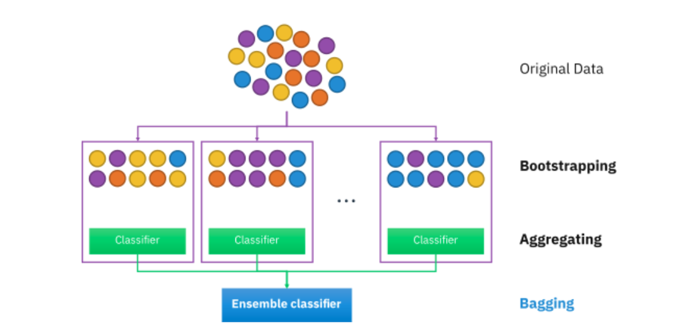

## 앙상블이란?

머신러닝을 위한 다양한 학습 알고리즘들을 결합하여 학습시키는 것으로, 예측력의 보완은 물론, 각자의 알고리즘을 단일로 사용할 경우 나타나는 단점들을 보완해 주는 기법입니다.

앙상블 기법은 큰 추상적인 개념이고, 구체적인 방법으로는 배깅(Bagging), 부스팅(Boosting), 스태킹(Stacking)등이 있습니다.

## 배깅(Bagging)

Bagging는 그 자체로 뜻이 있는 단어가 아닙니다. Bagging은 (**B**ootstrap **agg**regat**ing**) 의 약자 입니다. 즉, 부트스트랩들을 집계한다 라는 뜻으로 해석할 수 있습니다.

그렇다면 우선, Bootstrap 이 뭔지부터 알아야 합니다.

Bootstrap은 통계학에서 사용하는 용어로, 랜덤으로 샘플들을 뽑는 기법을 이야기 합니다. 만약, 공장의 불량품률이 몇이나 되는지를 측정하는 문제가 있다고 합시다. 모든 부품들을 다 꺼내어 불량검사를 하는것은 굉장히 비효율적인 일입니다. 여기에 `Bootstrap`개념을 적용하면, 약 100개의 샘플 상품들을 뽑은 뒤, 100개중에 불량품을 추출해내게 됩니다. 그리고 또 랜덤으로 약 100개의 샘플 상품들을 뽑은 뒤, 100개중에 불량품의 비율을 계산하게 됩니다. 그리고, 그 군집들의 불량품률을 계산하여 평균을 내면, 그 공장의 불량품률에 통계학적인 수치가 나옵니다.

이것을 머신러닝에 적용하게 되면, 적은 데이터 양으로도 학습 데이터를 늘릴 수 있습니다. 랜덤으로 적은 양의 데이터에서 군집을 형성하고, 그 군집에서 학습된 수치를 평균 내주면 되는 것이죠.

즉, Bagging은 Bootstrap을 집계 하여 학습 데이터가 충분하지 않더라도 충분한 학습효과를 주고, 특히 높은 variance로 인한 과적합(overfitting) 문제를 해결하는데 도움을 줍니다.

그걸 그림으로 표현하면 다음과 같습니다.

대표적인 Bagging 기법을 사용한 알고리즘이 랜덤 포레스트(Random Forest) 입니다.

## 부스팅(Boosting)

배깅이 여러 모델을 **병렬로** 따로 학습시켜 결과를 합친다면, 부스팅은 모델을 **순차적으로** 학습시킵니다.

먼저 약한 모델(weak learner) 하나를 학습시킨 뒤, 그 모델이 틀린 데이터에 가중치를 더 주어 다음 모델을 학습시킵니다. 이 과정을 반복하면 뒤에 오는 모델일수록 앞 모델의 실수를 보완하게 되고, 마지막에는 각 모델의 예측을 가중합해서 최종 결과를 냅니다.

- 배깅이 주로 **분산(variance)** 을 줄여 과적합을 막는다면, 부스팅은 주로 **편향(bias)** 을 줄여 과소적합을 해결합니다.
- 대신 틀린 데이터에 계속 집중하기 때문에, 노이즈가 많은 데이터에서는 오히려 과적합이 될 수 있습니다.
- 순차적으로 학습하므로 배깅보다 학습 속도가 느립니다.

대표적인 알고리즘으로는 AdaBoost, Gradient Boosting, 그리고 이를 개선한 XGBoost, LightGBM, CatBoost 등이 있습니다.

## 스태킹(Stacking)

스태킹은 서로 다른 종류의 모델들을 쌓아 올리는 방식입니다.

1. 랜덤 포레스트, SVM, KNN 처럼 서로 다른 여러 개의 모델(base model)을 학습시킵니다.
2. 각 모델의 예측값을 모아서 새로운 학습 데이터로 만듭니다.
3. 이 데이터를 가지고 최종 모델(meta model)을 한 번 더 학습시켜 최종 예측을 합니다.

즉, "어떤 모델의 예측을 얼마나 믿을지" 까지 모델이 학습하는 구조입니다. 성능을 끌어올리기 좋아서 Kaggle 같은 대회에서 많이 쓰입니다.

다만 base model 을 학습시킨 데이터로 그대로 meta model 을 학습시키면 과적합이 되기 쉽기 때문에, 보통 k-겹 교차 검증으로 예측값을 만들어서 사용합니다. 모델을 여러 단계로 학습시키다 보니 계산 비용이 크다는 단점도 있습니다.

## 정리

| 기법 | 학습 방식 | 주로 줄이는 것 | 대표 알고리즘 |
| --- | --- | --- | --- |
| 배깅 | 병렬, 같은 모델 여러 개 | 분산 (과적합) | Random Forest |
| 부스팅 | 순차, 앞 모델의 오류를 보완 | 편향 (과소적합) | AdaBoost, XGBoost, LightGBM |
| 스태킹 | 서로 다른 모델의 예측을 다시 학습 | 전반적인 성능 향상 | 메타 모델 (주로 로지스틱 회귀 등) |