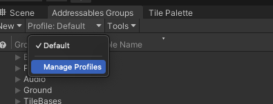
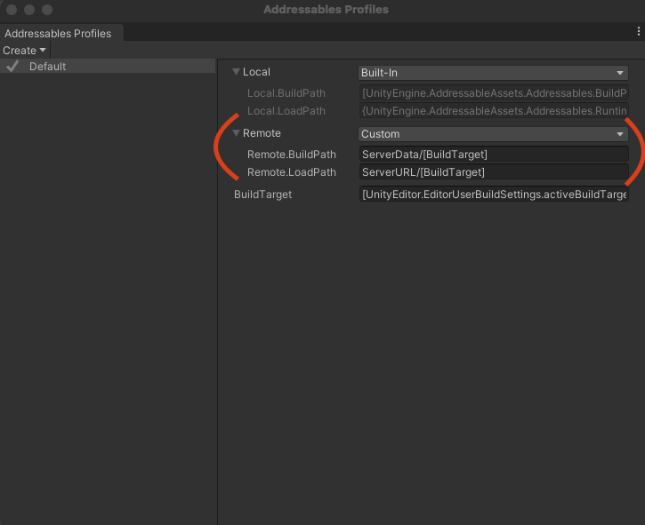
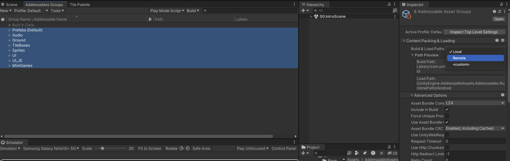
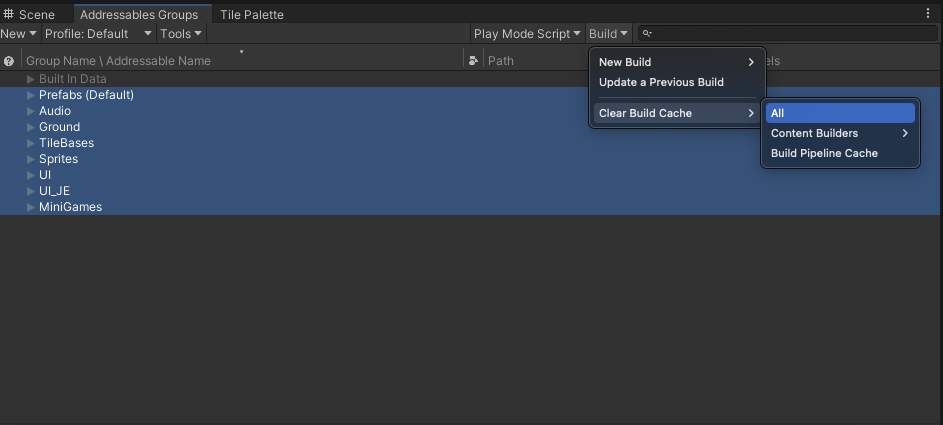
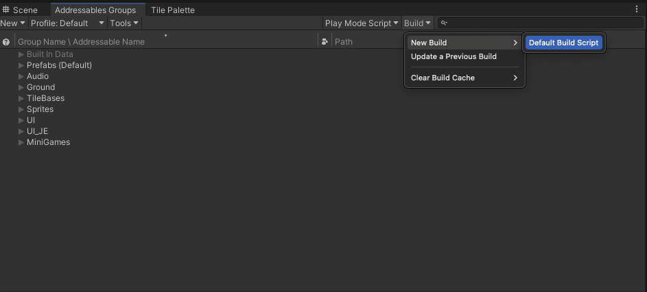
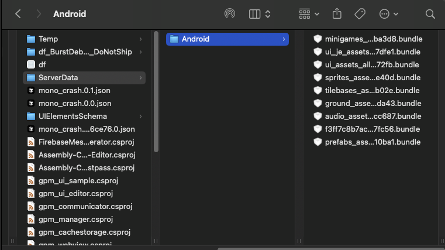
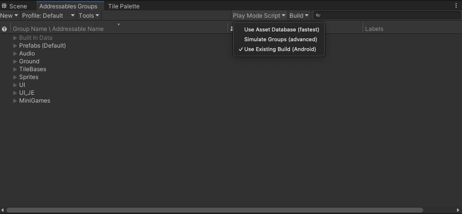

[이전 글](/game%20engine/2024/06/27/Addressable-Asset-%EC%82%AC%EC%9A%A9%EB%B2%95.html)에서는 Addressable 에셋을 로컬에 두고 불러오는 방법을 정리했습니다. 이번에는 Addressable 번들을 서버에서 내려받도록 설정을 바꾸는 과정을 정리해 보겠습니다.

## 1. Profile 에 Remote 경로 설정하기

`Addressables Groups` 창 상단의 `Profile: Default` 를 누르고 `Manage Profiles` 로 들어갑니다.

`Remote` 항목을 `Custom` 으로 바꾸고 두 경로를 입력합니다.

- **Remote.BuildPath** : 번들이 빌드되어 저장될 로컬 경로입니다. 예시에서는 `ServerData/[BuildTarget]` 으로 두었습니다.
- **Remote.LoadPath** : 앱이 번들을 내려받을 서버 주소입니다. `ServerURL` 자리에 실제 서버 주소를 넣고, 뒤에 `[BuildTarget]` 을 붙여 플랫폼별로 폴더를 나눕니다.

## 2. 그룹의 Build & Load Paths 를 Remote 로 바꾸기

서버로 옮길 그룹을 전부 선택한 뒤, Inspector 의 `Content Packing & Loading > Build & Load Paths` 를 `Local` 에서 `Remote` 로 바꿉니다.

## 3. 빌드 캐시 비우고 새로 빌드하기

이전에 로컬로 빌드한 결과가 남아 있으면 꼬일 수 있으니, `Build > Clear Build Cache > All` 로 캐시를 먼저 비웁니다.

그 다음 `Build > New Build > Default Build Script` 로 번들을 새로 빌드합니다.

빌드가 끝나면 프로젝트 폴더의 `ServerData/[BuildTarget]` (예시에서는 `ServerData/Android`) 에 `.bundle` 파일들이 생성됩니다. 이 파일들을 그대로 서버의 `Remote.LoadPath` 위치에 업로드하면 됩니다.

## 4. 에디터에서 서버 번들로 테스트하기

에디터에서도 실제 빌드된 번들을 받아오는지 확인하려면, `Play Mode Script` 를 `Use Existing Build` 로 바꾼 뒤 플레이합니다.

- **Use Asset Database (fastest)** : 번들 없이 에디터의 에셋을 바로 사용합니다. 개발 중에는 가장 빠릅니다.
- **Use Existing Build** : 실제로 빌드된 번들을 사용합니다. 서버 연동을 확인할 때 사용합니다.

에셋을 수정했다면 번들을 다시 빌드하고 서버에 다시 올려야 변경 사항이 반영된다는 점을 주의해야 합니다.
