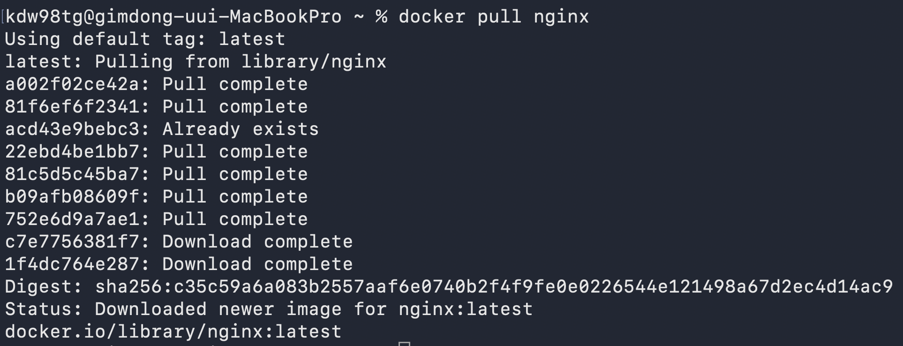
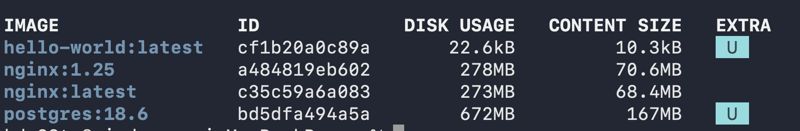
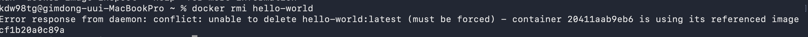
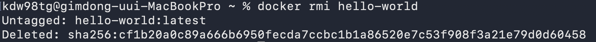

## 들어가며

[이미지와 컨테이너 개념](/docker/2026/11/24/Docker-이미지와-컨테이너-개념.html) 글에서 이미지가 무엇인지 정리했습니다. 이번 글에서는 실제로 이미지를 **받고, 확인하고, 찾고, 지우고, 정리하는** 명령어를 실습한 내용을 정리합니다.

## 1. 이미지 받기 - docker pull

```bash
docker pull nginx
```



출력 결과를 하나씩 보면 다음과 같습니다.

* `Using default tag: latest`: 태그를 적지 않으면 `latest` 태그를 받습니다.
* `a002f02ce42a: Pull complete`: 이미지를 이루는 **레이어**를 하나씩 받습니다.
* `acd43e9bebc3: Already exists`: 이미 가지고 있는 레이어는 다시 받지 않고 재사용합니다. 이미지가 레이어 구조인 이유(효율성)를 직접 확인할 수 있는 부분입니다.
* `Digest: sha256:...`: 이미지의 **고유 해시값**입니다. (아래에서 설명)
* `docker.io/library/nginx:latest`: 이미지가 저장된 경로입니다. `레지스트리(docker.io)/네임스페이스(library)/이미지 이름(nginx):태그(latest)` 형식입니다.

### Digest란?

Digest는 이미지 내용으로 계산한 **SHA-256 해시값**입니다. 내용이 1바이트라도 달라지면 Digest도 달라지기 때문에, Digest로 받으면 항상 **정확히 같은 이미지**를 받을 수 있습니다.

반면 태그(`latest` 등)는 이미지에 붙인 이름표라서, 같은 태그라도 나중에 새 버전을 가리키도록 바뀔 수 있습니다.

```bash
docker pull nginx@sha256:c35c59a6a083...   # Digest로 정확한 버전 지정
```

## 2. 이미지 확인하기

```bash
docker images              # 받은 이미지 목록
docker image ls            # 위와 같은 명령어
docker images nginx        # 이름으로 필터링해서 보기
docker image inspect nginx # 이미지 상세 정보(JSON)
```



* `ID`: 이미지의 고유 해시값(앞부분만 표시)입니다. 위의 `nginx:latest` ID가 pull 때 본 Digest 앞부분과 같은 것을 볼 수 있습니다.
* 같은 `nginx`라도 태그(`1.25`, `latest`)가 다르면 다른 이미지로 따로 관리됩니다.
* `EXTRA`의 `U`는 컨테이너가 **사용 중(In Use)**인 이미지라는 표시입니다.

## 3. 이미지 삭제하기 - docker rmi

```bash
docker rmi hello-world        # 이미지 삭제
docker rm [컨테이너 ID 또는 이름] # 컨테이너 삭제
```

그런데 `hello-world` 이미지를 바로 지우려고 하면 에러가 납니다.



`container 20411aab9eb6 is using its referenced image` - 이 이미지를 **참조하고 있는 컨테이너**가 있어서 삭제할 수 없다는 뜻입니다. 앞에서 본 `U` 표시가 바로 이 상태입니다. (실행이 끝난 컨테이너도 지우기 전까지는 이미지를 참조하고 있습니다.)

그래서 **컨테이너를 먼저 지우고**(`docker rm 20411aab9eb6`) 이미지를 지우면 정상적으로 삭제됩니다.



* `Untagged`: `hello-world:latest` 태그를 떼어냄
* `Deleted`: 이미지 자체를 삭제함

## 4. 이미지 찾기 - docker search

이미지는 두 가지 방법으로 찾을 수 있습니다.

1. [Docker Hub](https://hub.docker.com) 웹사이트에서 찾기
2. 터미널에서 `docker search`로 찾기

```bash
docker search python
docker search --filter is-official=true python   # 공식 이미지만
docker search --filter stars=100 python          # 스타 100개 이상만
```

### 믿을 수 있는 이미지 고르기

* Docker Hub에서는 공식 이미지에 **Docker Official Image 뱃지**가 붙어 있고, `docker search` 결과에서는 `OFFICIAL` 칸에 `[OK]`가 표시됩니다.
* 공식 이미지는 이름에 **`/`가 없습니다.** (`python`, `nginx` 등) 공식 이미지는 보안 검토와 정기적인 업데이트가 이루어집니다.
* `/`가 있는 이미지(`사용자명/이미지명`)는 개인이나 회사가 올린 이미지이므로, **스타 개수, 정기적으로 업데이트되는지** 등을 꼭 확인하고 써야 합니다.

### 태그와 slim, alpine

**태그**는 같은 이미지의 버전이나 변형을 구분하는 이름표입니다. (`nginx:1.25`, `python:3.12-slim` 등) 태그를 생략하면 `latest`가 사용됩니다.

태그 중에는 이미지 크기를 줄인 변형이 있습니다.

| 태그 | 특징 |
| --- | --- |
| (기본) | 필요한 도구가 많이 포함되어 있어 크기가 큼 |
| `slim` | 기본 이미지에서 꼭 필요하지 않은 패키지를 뺀 가벼운 버전 |
| `alpine` | Alpine Linux 기반으로 **엄청 가벼움**. 다만 일반적인 리눅스 배포판과 C 라이브러리(musl)가 달라서 호환성 문제가 생길 수 있음 |

웬만하면 `slim`을 쓰면 됩니다.

## 5. 디스크 정리하기

이미지와 컨테이너를 계속 받고 만들다 보면 디스크를 많이 차지하게 됩니다.

```bash
docker system df      # 이미지, 컨테이너, 볼륨, 빌드 캐시가 차지하는 디스크 용량
docker system df -v   # 항목별로 자세히
docker history nginx  # 이미지를 이루는 레이어와 각 레이어 크기
```

### dangling 이미지

**dangling 이미지**는 이름과 태그가 없는(`<none>:<none>`) 이미지입니다. 같은 이름과 태그로 이미지를 새로 받거나 빌드하면, 태그가 새 이미지로 옮겨가면서 이전 이미지가 이름 없이 남게 됩니다.

```bash
docker image prune -f
```

* dangling 이미지를 삭제합니다. (`-f`는 확인 질문 없이 바로 실행)
* 디스크 사용량을 줄이고 싶을 때 **제일 먼저 해볼 만한** 명령어이고, 주기적으로 정리해 주는 게 좋습니다.

```bash
docker system prune -a
```

* 중지된 컨테이너, 사용하지 않는 네트워크, **사용하지 않는 모든 이미지**, 빌드 캐시까지 전부 정리합니다.
* 대신 지운 이미지가 다시 필요하면 **다시 받아야** 합니다.

## 정리

| 명령어 | 설명 |
| --- | --- |
| `docker pull nginx` | 이미지 받기 (태그 생략 시 `latest`) |
| `docker images` / `docker image ls` | 이미지 목록 |
| `docker image inspect nginx` | 이미지 상세 정보 |
| `docker rmi hello-world` | 이미지 삭제 (참조하는 컨테이너가 있으면 실패) |
| `docker rm [컨테이너]` | 컨테이너 삭제 |
| `docker search --filter is-official=true python` | 공식 이미지 검색 |
| `docker system df` | 디스크 사용량 확인 |
| `docker history nginx` | 이미지 레이어 확인 |
| `docker image prune -f` | dangling 이미지 정리 |
| `docker system prune -a` | 안 쓰는 리소스 전부 정리 |

* 이미지는 레이어 단위로 받고, 이미 있는 레이어는 재사용함
* Digest는 이미지 내용의 고유 해시값, 태그는 바뀔 수 있는 이름표
* 공식 이미지는 이름에 `/`가 없고, 웬만하면 `slim` 태그를 쓰면 됨
* 컨테이너가 참조 중인 이미지는 컨테이너를 먼저 지워야 삭제 가능
