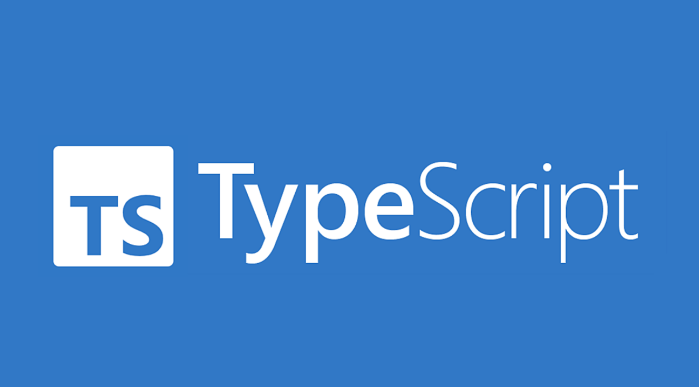

## 들어가며

타입스크립트 교과서 4장을 공부하면서 정리한 내용입니다. 앞에서는 [기본 타입](/languages/2026/11/12/TypeScript-%EA%B8%B0%EB%B3%B8-%ED%83%80%EC%9E%85-%EC%A0%95%EB%A6%AC.html)과 [유틸리티 타입](/languages/2026/11/12/TypeScript-%EC%9C%A0%ED%8B%B8%EB%A6%AC%ED%8B%B0-%ED%83%80%EC%9E%85-%EC%A7%81%EC%A0%91-%EB%A7%8C%EB%93%A4%EA%B8%B0.html)을 다뤘는데, 이번에는 타입스크립트 코드를 실제로 검사하고 자바스크립트로 변환하는 `tsc` 명령어와, 그 동작을 정하는 `tsconfig.json` 을 정리해 보겠습니다.

브라우저나 Node.js 는 타입스크립트를 바로 실행하지 못합니다. 그래서 `.ts` 파일을 `.js` 로 바꿔주는 과정이 필요한데, 이걸 해주는 것이 타입스크립트 컴파일러 `tsc` 입니다.

## 1. 타입스크립트 설치하기

프로젝트 폴더에서 npm 으로 설치합니다.

```bash
npm i typescript
```

특정 버전을 쓰고 싶다면 `@버전` 을 붙입니다. 책과 같은 결과를 보려고 저는 책의 버전에 맞춰 설치했습니다.

```bash
npm i typescript@5.0.4
```

전역(`-g`)이 아니라 프로젝트에 설치하면, 프로젝트마다 다른 타입스크립트 버전을 쓸 수 있고 팀원들도 같은 버전을 쓰게 됩니다. 프로젝트에 설치한 `tsc` 는 `npx` 로 실행합니다.

## 2. tsc 명령어

### 자바스크립트로 변환하기

```bash
npx tsc
```

`tsconfig.json` 설정에 따라 타입 검사를 하고, `.ts` 파일을 `.js` 파일로 변환합니다.

### 타입 검사만 하기

```bash
npx tsc --noEmit
```

`--noEmit` 을 붙이면 `.js` 파일을 만들지 않고 **타입 에러만 검사**합니다. 실제 변환은 Vite 같은 번들러가 해주는 프로젝트에서는 `tsc` 를 타입 검사 용도로만 쓰는 경우가 많아서 자주 쓰는 옵션입니다.

### 에러가 없을 때만 변환하기

```bash
npx tsc --noEmitOnError
```

사실 `tsc` 는 타입 에러가 있어도 기본적으로 자바스크립트 파일을 **만들어 버립니다.** 타입은 실행에 영향을 주지 않기 때문입니다.

`--noEmitOnError` 를 붙이면 에러가 있을 때는 변환하지 않고 에러만 보여주고, 에러가 없을 때만 변환합니다. 에러가 있는 코드가 실수로 배포되는 것을 막을 수 있습니다.

### 정리

| 명령어 | 타입 검사 | JS 파일 생성 |
| --- | --- | --- |
| `npx tsc` | O | 항상 |
| `npx tsc --noEmit` | O | X |
| `npx tsc --noEmitOnError` | O | 에러가 없을 때만 |

## 3. package.json 스크립트로 등록하기

명령어를 매번 치기 귀찮으니 `package.json` 의 `scripts` 에 등록해 두었습니다.

```json
{
  "scripts": {
    "typecheck": "tsc --noEmit",
    "typecheck:watch": "tsc --noEmit --watch",
    "build": "tsc"
  },
  "devDependencies": {
    "typescript": "5.0.4"
  }
}
```

- `npm run typecheck` : 타입 검사만
- `npm run typecheck:watch` : 파일을 저장할 때마다 자동으로 다시 검사 (`--watch`)
- `npm run build` : 자바스크립트로 변환

`scripts` 안에서는 `npx` 를 붙이지 않아도 프로젝트에 설치된 `tsc` 가 실행됩니다.

## 4. tsconfig.json

`tsc` 를 어떻게 동작시킬지는 프로젝트 최상단의 `tsconfig.json` 에서 정합니다. 기본 파일은 다음 명령어로 만들 수 있습니다.

```bash
npx tsc --init
```

공부용 프로젝트에서 사용한 설정 중 주요 부분만 추리면 다음과 같습니다.

```json
{
  "compilerOptions": {
    "target": "ES2022",
    "module": "ESNext",
    "moduleResolution": "node",
    "lib": ["ES2022", "DOM", "DOM.Iterable"],
    "strict": true,
    "noImplicitReturns": true,
    "esModuleInterop": true,
    "forceConsistentCasingInFileNames": true,
    "rootDir": ".",
    "outDir": "./dist",
    "noEmitOnError": true
  },
  "include": ["chapter*/**/*.ts", "chapter*/**/*.tsx"],
  "exclude": ["node_modules", "dist"]
}
```

### 어떤 파일을 검사할지

- **include** : 컴파일할 파일. 챕터 폴더(`chapter01`, `chapter02` ...) 안의 `.ts`, `.tsx` 파일만 대상으로 잡았습니다.
- **exclude** : 제외할 폴더. `node_modules` 와 결과물 폴더 `dist` 는 검사할 필요가 없습니다.
- **rootDir / outDir** : 원본 기준 폴더와 변환된 `.js` 가 저장될 폴더입니다. `outDir` 을 정하지 않으면 `.ts` 옆에 `.js` 가 생겨서 폴더가 지저분해집니다.

### 어떤 자바스크립트로 변환할지

- **target** : 어떤 버전의 자바스크립트 문법으로 변환할지 정합니다. `ES2022` 면 최신 문법을 거의 그대로 유지하고, `ES5` 처럼 낮추면 화살표 함수나 클래스 같은 문법을 옛날 문법으로 바꿔줍니다.
- **module** : `import` / `export` 를 어떤 모듈 방식으로 변환할지 정합니다. `ESNext` 는 `import` 문을 그대로 둡니다.
- **lib** : 코드에서 사용할 수 있는 내장 타입 목록입니다. `DOM` 을 넣어야 `document`, `window` 같은 브라우저 API 의 타입을 쓸 수 있습니다.

### 얼마나 엄격하게 검사할지

- **strict** : 엄격한 타입 검사 옵션들을 한 번에 켭니다. 2장에서 봤던 implicit any 에러(`noImplicitAny`), `null` 체크(`strictNullChecks`), `catch` 의 `e` 를 `unknown` 으로 받는 것(`useUnknownInCatchVariables`) 등이 전부 여기에 포함됩니다. **처음부터 켜두는 것을 추천합니다.**
- **noImplicitReturns** : 함수의 일부 경로에서만 값을 반환하면 에러를 냅니다.
- **noEmitOnError** : 위에서 본 `--noEmitOnError` 를 설정 파일에 넣어둔 것입니다. 이제 그냥 `tsc` 만 실행해도 에러가 있으면 변환하지 않습니다.

### 그 외

- **esModuleInterop** : `import React from "react"` 처럼 CommonJS 로 만든 라이브러리를 ES 모듈 방식으로 `import` 할 수 있게 해줍니다.
- **forceConsistentCasingInFileNames** : `import` 할 때 파일 이름의 대소문자가 실제와 다르면 에러를 냅니다. 윈도우에서는 대소문자를 구분하지 않아서 잘 되다가, 리눅스 서버에 배포하면 깨지는 문제를 막아줍니다.

## 마치며

`tsc` 는 결국 **타입 검사기**이자 **변환기**이고, 둘 중 무엇을 얼마나 엄격하게 할지는 `tsconfig.json` 이 정합니다. 처음에는 옵션이 너무 많아 보이지만, `include` / `outDir` / `target` / `strict` 정도만 이해해도 대부분의 프로젝트 설정은 읽을 수 있을 것 같습니다.
