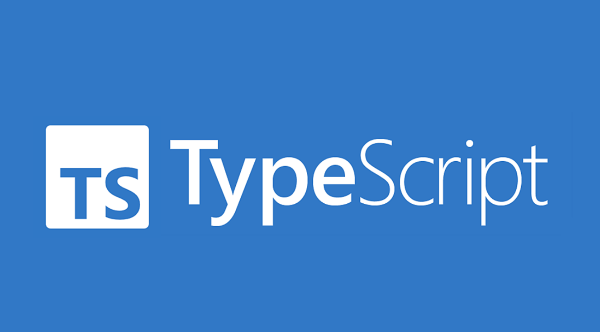

## 들어가며

타입스크립트 교과서 2장을 공부하면서 정리한 내용입니다. 타입 표기부터 제네릭까지, 타입스크립트의 기본 타입 시스템을 다룹니다.

## 1. 타입 표기와 타입 추론

변수 이름 뒤에 `: 타입` 을 붙여서 타입을 표기합니다.

```ts
let hello: string = "Hello, TypeScript!";

function add(x: number, y: number): number {
  return x + y;
}
```

매개변수에 타입을 표기하지 않으면 `any` 타입이 되고, `Parameter 'x' implicitly has an 'any' type.` 에러가 납니다. 이를 **implicit any 에러**라고 합니다.

그렇다고 모든 변수에 타입을 붙여야 하는 건 아닙니다. 책 저자의 원칙은 다음과 같습니다.

> 타입스크립트가 타입을 제대로 추론하면 그대로 쓰고, 틀리게 추론할 때만 올바른 타입을 표기한다.

### const 와 let 의 추론 차이

`const` 로 선언한 값은 바뀔 일이 없으니 **리터럴 타입**으로 추론됩니다.

```ts
const str = "hello"; // "hello"
const num = 123;     // 123
const bool = false;  // false
```

반면 `let` 은 값이 바뀔 수 있으므로 더 넓은 타입으로 추론합니다. 이를 **타입 넓히기(Type Widening)** 라고 합니다.

```ts
let str = "hello"; // string
let num = 123;     // number
let bool = false;  // boolean
```

몇 가지 특이한 점도 있습니다.

- 객체는 `const` 로 선언해도 안의 값이 바뀔 수 있으므로 `{ hello: string }` 처럼 속성은 넓은 타입으로 추론됩니다.
- `let` 변수에 `null`, `undefined` 를 대입하면 `any` 로 추론됩니다.
- `const` 로 선언한 심볼은 각각 `unique symbol` 타입이 되어, `sym1 === sym2` 처럼 비교하면 타입 에러가 납니다. (JS에서는 비교 가능)

### @ts-ignore 와 @ts-expect-error

- `// @ts-ignore` : 다음 줄의 타입 에러를 무시합니다.
- `// @ts-expect-error` : 다음 줄에 **반드시 에러가 있어야** 합니다. 에러가 없으면 오히려 에러가 납니다.

둘 다 안 쓰는 게 좋지만, 굳이 써야 한다면 의도를 드러내는 `@ts-expect-error` 를 쓰는 편이 낫습니다.

## 2. 리터럴 타입과 as const

값 자체를 타입으로 쓸 수 있습니다.

```ts
let str: "hello" = "hello";
// str = "123"; // 에러

const obj: { name: "zero" } = { name: "zero" };
const func: (amount: number, unit: string) => string = (amount, unit) => amount + unit;
```

함수 타입에서는 반환값을 `:` 가 아니라 `=>` 로 표기한다는 점에 주의해야 합니다.

일일이 리터럴 타입을 적는 대신 `as const` 를 붙이면 리터럴 타입 + 읽기 전용으로 추론됩니다.

```ts
const obj1 = { name: "zero" };
obj1.name = "123"; // 가능

const obj2 = { name: "zero" } as const;
// obj2.name = "123"; // 에러

const arr = [1, 3, "five"] as const; // readonly [1, 3, "five"]
// arr.push(1); // 에러
```

`const` 는 변수의 **재대입**을 막고, `readonly` 는 **요소 변경**까지 막습니다. 다만 `readonly` 는 타입 검사에서만 적용되고, 실행 중에 배열을 실제로 얼리지는 않습니다.

## 3. 배열과 튜플

배열은 두 가지 방식으로 선언할 수 있습니다.

```ts
const arr1: string[] = ["1", "2", "3"];
const arr2: Array<number> = [1, 2, 3];

const arr3 = [1, 2, 3];   // number[]
const arr4 = [1, "2", 3]; // (string | number)[]
const arr5 = [];          // any[]
```

JS 배열은 없는 인덱스에 접근해도 그냥 `undefined` 가 나옵니다. 각 위치의 타입과 길이까지 정하고 싶다면 **튜플**을 사용합니다.

```ts
const tuple: [number, boolean, string] = [1, false, "hi"];
// tuple[3] = "no"; // 에러: 없는 요소
tuple.push("4");    // 이건 됨...
```

튜플이어도 `push` 는 막히지 않습니다. 수정까지 막으려면 `readonly` 를 붙여야 합니다.

```ts
const tuple: readonly [number, boolean, string] = [1, false, "hi"];
```

전개 문법으로 가변 길이 튜플도 만들 수 있습니다.

```ts
const a: [string, number, ...boolean[]] = ["hi", 1, true, false];
const b: [string, ...number[], boolean] = ["hi", 1, 2, 3, false];
const c: [...string[], number, boolean] = ["hi", "1", "2", 3, false];
```

## 4. 타입으로 쓸 수 있는 값

`Date`, `Math` 처럼 내장 객체는 타입으로도 쓸 수 있습니다.

`String`, `Number`, `Boolean` 같은 래퍼 객체도 타입으로 쓸 수는 있지만, `Number + Number` 가 안 되고 `string` 에 `String` 을 대입할 수 없는 등 불편한 점이 많습니다. 소문자 `string`, `number` 를 쓰는 것이 좋습니다.

함수의 타입을 그대로 가져오고 싶다면 `typeof` 를 사용합니다.

```ts
function add(x: number, y: number) {
  return x + y;
}
const add2: typeof add = (x, y) => x + y;
```

## 5. 유니언 타입과 타입 좁히기

`|` 로 "A 또는 B" 를 표현합니다.

```ts
function returnNumber(value: string | number) {
  if (typeof value === "string") {
    return parseInt(value); // 여기서 value는 string
  }
  return value; // 여기서 value는 number
}
```

`parseInt` 는 `string` 만 받기 때문에, `typeof` 검사로 타입을 좁혀줘야 합니다. 이를 **타입 좁히기(Type Narrowing)** 라고 합니다.

## 6. 타입스크립트에만 있는 타입

### any

모든 타입을 허용합니다. 사실상 **타입 검사를 포기한다는 선언**이라 지양해야 합니다.

```ts
let str: any = "hello";
const result = str.toFixed(); // string인데 toFixed가 됨. result도 any
```

`any` 에서 파생된 값도 전부 `any` 가 됩니다. 타입스크립트가 `any` 로 추론하는 곳이 있다면 직접 타입을 표기해 주어야 합니다.

### unknown

`any` 처럼 모든 값을 대입할 수 있지만, 대입한 후에는 **아무 동작도 할 수 없습니다.**

```ts
try {
} catch (e) {
  // console.log(e.message); // 에러: e는 unknown
  const error = e as Error;
  console.log(error.message);
}
```

이럴 때 `as` 로 타입을 명시하는 것을 **타입 단언(Type Assertion)** 이라고 합니다. `<Error>e` 형태도 있지만 JSX 문법과 충돌하므로 `as` 를 추천합니다.

### void

반환값이 없는 함수의 반환 타입입니다. JS에서는 반환값이 없으면 `undefined` 가 반환되지만, TS에서는 타입이 `void` 가 됩니다.

재미있는 점은 **함수 타입**에 `void` 를 쓰면 실제로 값을 반환해도 에러가 나지 않는다는 것입니다.

```ts
const func: () => void = () => 3; // OK
const value = func(); // 실제 값은 3이지만 타입은 void

// const func2 = (): void => 3; // 에러
```

`() => void` 타입은 "반환값을 신경 쓰지 않겠다" 는 뜻이라 반환값이 있어도 허용됩니다. 반면 함수 선언에 직접 `: void` 를 붙이면 반환값이 있을 때 에러가 납니다.

### {} 와 object

`{}` 타입은 객체가 아니라 **`null`, `undefined` 를 제외한 모든 값**을 의미합니다.

```ts
const a: {} = "hello";
const b: {} = 123;
const c: {} = { key: "value" };
// const d: {} = null; // 에러
```

다만 대입만 될 뿐, 실제로 사용하려 하면 `c.key` 처럼 속성 접근이 막힙니다. `{}` 에 `null`, `undefined` 까지 더하면 `unknown` 과 같아집니다.

### never

**절대 발생하지 않는 값**의 타입입니다. 어떤 값도 대입할 수 없습니다. 주로 정상 종료되지 않는 함수에 씁니다.

```ts
function fail(message: string): never {
  throw new Error(message);
}
```

가능한 타입을 전부 제거해도 `never` 가 남습니다.

```ts
function check(value: string | number) {
  if (typeof value === "string") return;
  if (typeof value === "number") return;

  const remaining: never = value; // 남은 타입이 없음
}
```

### undefined 와 null

둘 다 "값이 없다" 를 나타내지만 의도가 다릅니다.

- `undefined` : 아직 값이 정해지지 않은 상태
- `null` : 의도적으로 비워둔 상태

## 7. 타입 별칭과 인터페이스

### 타입 별칭

`type` 으로 기존 타입에 이름을 붙입니다. 주로 복잡하거나 가독성이 낮은 타입에 사용합니다.

```ts
type ValueWithUnit = (value: number, unit: string) => string;
const func: ValueWithUnit = (value, unit) => value + unit;
```

### 인터페이스

객체 타입에 이름을 붙이는 또 하나의 방법입니다.

```ts
interface Person {
  name: string;
  age: number;
  married: boolean;
}

interface Func {
  (x: number, y: number): number;
}
```

인덱스 시그니처로 "키가 number 인 속성" 을 표현할 수도 있습니다.

```ts
interface Arr {
  length: number;
  [key: number]: string;
}
const arr: Arr = ["2", "3", "4"]; // OK
```

배열은 `length` 와 숫자 키를 가지고 있으니 대입이 됩니다. 하지만 `Arr` 에 정의되지 않은 `push`, `map` 같은 메서드는 사용할 수 없습니다.

### 선언 병합

같은 이름의 인터페이스를 여러 번 선언하면 하나로 합쳐집니다. 이를 **선언 병합(Declaration Merging)** 이라고 합니다.

```ts
interface Merge { one: string; }
interface Merge { two: number; }

const example: Merge = { one: "1", two: 2 };
```

Java, C# 에서는 다른 사람이 만든 인터페이스를 수정할 수 없지만, TS는 이렇게 확장을 허용해 줍니다.

### 네임스페이스

반대로 남이 만든 인터페이스와 **의도치 않게** 병합될 위험도 있습니다. 이럴 때 네임스페이스로 이름을 감쌀 수 있습니다. 밖에서 쓰려면 `export` 해야 하고, 네임스페이스도 이름이 겹치면 병합됩니다.

```ts
namespace Example {
  export interface Inner {
    test: string;
  }
}
const ex: Example.Inner = { test: "hello" };
```

## 8. 객체의 속성

### 초과 속성 검사

인터페이스는 "해당 속성을 **포함**해야 한다" 는 조건입니다. 그런데 객체 리터럴을 바로 대입하면 정의되지 않은 속성도 검사합니다.

```ts
interface Example {
  hello: string;
}

// const example: Example = { hello: "hi", why: "나는 에러" }; // 에러

const obj = { hello: "hi", why: "나는 에러 아님" };
const example2: Example = obj; // OK
```

### 인덱스 접근 타입

다른 타입의 속성 타입을 그대로 가져올 수 있습니다. 원본 타입이 바뀌면 자동으로 따라 바뀌어서 관리가 편합니다.

```ts
type Animal = { name: string };
type NameType = Animal["name"]; // string
```

## 9. 타입을 집합으로 생각하기

- `|` (유니언) : 합집합
- `&` (인터섹션) : 교집합
- `unknown` : 전체 집합
- `never` : 공집합

`string & number` 는 "string 이면서 number 인 값" 이라 존재하지 않으므로 `never` 가 됩니다.

대입은 항상 **좁은 타입에서 넓은 타입으로**만 가능합니다. 그리고 `any` 는 이 집합 규칙에서 예외입니다.

## 10. 타입 상속

인터페이스는 `extends`, 타입 별칭은 `&` 로 상속합니다.

```ts
interface Animal {
  name: string;
}
interface Dog extends Animal {
  bark(): void;
}

type Cat = Animal & {
  meow(): void;
};
```

자식에서 부모의 속성 타입을 바꿀 수도 있지만, **더 좁은 타입으로만** 바꿀 수 있습니다.

## 11. 구조적 타이핑

TS는 이름이 달라도 **구조가 같으면 같은 타입**으로 취급합니다. 이를 **구조적 타이핑(Structural Typing)** 이라고 합니다.

```ts
interface Money { amount: number; unit: string; }
interface Liter { amount: number; unit: string; }

const liter: Liter = { amount: 1, unit: "liter" };
const money: Money = liter; // OK
```

C# 이나 Java 처럼 이름으로 타입을 구분하는 언어에 익숙하면 처음에 헷갈리는 부분입니다.

## 12. 제네릭

중복되는 타입을 함수처럼 매개변수화할 수 있습니다.

```ts
interface Person<N, A> {
  type: "human";
  race: "yellow";
  name: N;
  age: A;
}

interface Zero extends Person<"zero", 28> {}
interface Nero extends Person<"nero", 32> {}
```

함수에서는 **선언문이냐 표현식이냐**에 따라 제네릭 위치가 다르니 주의해야 합니다.

```ts
function personFactory<N, A>(name: N, age: A) {
  return { type: "human", race: "yellow", name, age };
}

const personFactoryE = <N, A>(name: N, age: A) => ({
  type: "human", race: "yellow", name, age,
});
```

### 기본값과 제약

```ts
// 기본값
interface Person<N = string, A = number> { /* ... */ }

// 제약 (C#의 where 와 비슷)
interface Example<A extends number, B = string> {
  a: A;
  b: B;
}
// type U1 = Example<string, boolean>; // 에러
type U2 = Example<1>;
```

자주 쓰는 제약은 다음과 같습니다.

| 제약 | 의미 |
| --- | --- |
| `<T extends object>` | 모든 객체 |
| `<T extends any[]>` | 모든 배열 |
| `<T extends (...args: any) => any>` | 모든 함수 |
| `<T extends abstract new (...args: any) => any>` | 모든 생성자 |
| `<T extends keyof any>` | `string \| number \| symbol` |

## 13. 함수

### 나머지 매개변수

```ts
function example(a: string, ...b: number[]) {}
example("hi", 1, 2, 3);
```

### 콜백 함수의 매개변수

인수로 넘기는 콜백 함수의 매개변수에는 타입을 표기하지 않아도 됩니다. 문맥상 추론되기 때문입니다(**문맥적 추론**).

```ts
function example(callback: (error: Error, result: string) => void) {}

example((e, r) => {}); // e: Error, r: string
example(() => {});     // 안 쓰는 매개변수는 생략 가능
example(() => true);   // 반환 타입이 void라 반환값이 있어도 OK
```

안 쓸 매개변수라고 옵셔널(`?`)로 만드는 건 좋지 않습니다. 타입이 `| undefined` 가 되어 의도와 다르게 동작할 수 있기 때문입니다.

## 14. 타입 가드

`is` 키워드로 직접 타입 좁히기 함수를 만들 수 있습니다.

```ts
interface A {
  name: string;
}

function isA(value: unknown): value is A {
  return typeof value === "object" && value !== null && "name" in value;
}
```

`isA(x)` 가 `true` 이면, 그 블록 안에서 `x` 는 `A` 타입으로 취급됩니다.

## 마치며

C# 을 쓰다가 타입스크립트를 보니, 비슷해 보여도 **구조적 타이핑**과 **타입을 집합으로 보는 관점**이 가장 큰 차이였습니다. 2장 뒷부분(조건부 타입, infer, 템플릿 리터럴 타입 등)은 따로 정리해서 올리겠습니다.
