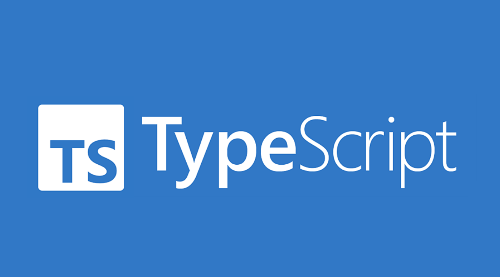

## 들어가며

타입스크립트 교과서 3장을 공부하면서 정리한 내용입니다. [이전 글](/languages/2026/11/12/TypeScript-%EA%B8%B0%EB%B3%B8-%ED%83%80%EC%9E%85-%EC%A0%95%EB%A6%AC.html)에서는 타입스크립트의 기본 타입을 다뤘습니다.

타입스크립트에는 `Partial`, `Pick`, `Omit` 처럼 기존 타입을 가공해서 새 타입을 만들어 주는 **유틸리티 타입**이 기본으로 들어 있습니다. 이번 글에서는 이 유틸리티 타입들을 그냥 쓰는 게 아니라, `My` 를 붙여서 **직접 구현**해 보면서 어떻게 동작하는지 알아보겠습니다.

## 미리 알아야 할 문법

유틸리티 타입은 대부분 두 가지 문법으로 만들어집니다.

### 매핑된 객체 타입

```ts
type Example<T> = {
  [P in keyof T]: T[P];
};
```

- `keyof T` : `T` 의 모든 속성 키를 유니언으로 꺼냅니다. `{ a: string; b: number }` 라면 `"a" | "b"` 입니다.
- `[P in ...]` : 유니언의 각 키를 하나씩 돌면서 속성을 만듭니다. `for...in` 과 비슷하게 생각하면 됩니다.
- `T[P]` : 원래 타입에서 그 키의 타입을 가져옵니다. (인덱스 접근 타입)

즉, 위 코드는 `T` 를 그대로 복사하는 타입입니다. 여기에 `?`, `readonly` 같은 수식어를 붙였다 뗐다 하면서 유틸리티 타입을 만들게 됩니다.

### 컨디셔널 타입

```ts
type Example<T, U> = T extends U ? X : Y;
```

`T` 가 `U` 에 대입 가능하면 `X`, 아니면 `Y` 가 됩니다. 삼항 연산자와 같은 모양입니다.

## 1. 매핑된 객체 타입으로 만드는 유틸리티

### Partial - 모든 속성을 옵셔널로

```ts
type MyPartial<T> = {
  [P in keyof T]?: T[P];
};

type Result1 = MyPartial<{ a: string; b: number }>;
// { a?: string; b?: number }
```

각 속성 뒤에 `?` 를 붙여서 전부 옵셔널로 만듭니다.

### Required - 모든 속성을 필수로

```ts
type MyRequired<T> = {
  [P in keyof T]-?: T[P];
};

type Result2 = MyRequired<{ a?: string; b?: number }>;
// { a: string; b: number }
```

`Partial` 의 반대입니다. `-?` 는 **옵셔널 수식어를 제거**한다는 뜻입니다.

### Readonly - 모든 속성을 읽기 전용으로

```ts
type MyReadonly<T> = {
  readonly [P in keyof T]: T[P];
};

// 반대로 readonly 를 제거하려면 -readonly
type ReverseReadonly<T> = {
  -readonly [P in keyof T]: T[P];
};
```

`?` 와 마찬가지로 `readonly` 도 앞에 `-` 를 붙이면 제거할 수 있습니다. `ReverseReadonly` 는 기본 유틸리티 타입에는 없지만 같은 방식으로 만들 수 있습니다.

### Pick - 지정한 속성만 골라내기

```ts
type MyPick<T, K extends keyof T> = {
  [P in K]: T[P];
};

type Result3 = MyPick<{ a: string; b: number; c: number }, "a" | "b">;
// { a: string; b: number }
```

`keyof T` 전체를 도는 대신, 넘겨받은 키 `K` 만 돕니다. `K extends keyof T` 제약 덕분에 `T` 에 없는 키를 넣으면 에러가 납니다.

### Record - 모든 속성의 타입이 같은 객체

```ts
type MyRecord<K extends keyof any, T> = {
  [P in K]: T;
};

type Result4 = MyRecord<"a" | 1, string>;
// { a: string; 1: string }
```

키 목록 `K` 를 돌면서 값 타입을 전부 `T` 로 채웁니다. `keyof any` 는 `string | number | symbol` 이라서, 객체의 키가 될 수 있는 타입만 받도록 제한한 것입니다.

## 2. 컨디셔널 타입으로 만드는 유틸리티

### Exclude - 지정한 타입을 제거

```ts
type MyExclude<T, U> = T extends U ? never : T;

type Result5 = MyExclude<1 | "2" | 3, string>;
// 1 | 3
```

언뜻 보면 `1 | "2" | 3` 전체가 `string` 에 대입 가능한지를 한 번만 검사할 것 같지만, 실제로는 유니언의 **각 멤버마다 따로** 검사합니다. 이를 **분배법칙(distributive conditional type)** 이라고 합니다.

```
1   extends string ? never : 1    → 1
"2" extends string ? never : "2"  → never
3   extends string ? never : 3    → 3
```

결과를 다시 유니언으로 합치면 `1 | never | 3` 이고, `never` 는 공집합이라 사라지므로 `1 | 3` 이 됩니다.

### Extract - 지정한 타입만 추출

```ts
type MyExtract<T, U> = T extends U ? T : never;

type Result6 = MyExtract<1 | "2" | 3, string>;
// "2"
```

`Exclude` 와 반대로, 조건에 맞는 것만 남깁니다.

### NonNullable - null, undefined 제거

```ts
type MyNonNullable<T> = T extends null | undefined ? never : T;

type Result7 = MyNonNullable<string | number | null | undefined>;
// string | number
```

사실상 `Exclude<T, null | undefined>` 와 같습니다.

## 3. 유틸리티 타입 조합하기

### Omit - 지정한 속성을 제거

```ts
type MyOmit<T, K extends keyof any> = Pick<T, Exclude<keyof T, K>>;

type Result8 = MyOmit<{ a: "1"; b: 2; c: true }, "a" | "c">;
// { b: 2 }
```

`Omit` 은 새로 만들지 않고 앞에서 만든 것들을 조합합니다.

1. `keyof T` 로 모든 키 `"a" | "b" | "c"` 를 꺼내고
2. `Exclude` 로 제거할 키 `"a" | "c"` 를 빼서 `"b"` 만 남긴 뒤
3. `Pick` 으로 남은 키만 골라냅니다.

### Optional - 특정 속성만 옵셔널로

기본 유틸리티 타입에는 없지만, 실무에서 자주 필요한 타입입니다.

```ts
type Optional<T, K extends keyof T> = Omit<T, K> & Partial<Pick<T, K>>;

type Result9 = Optional<{ a: "hi"; b: 123 }, "a">;
// { b: 123 } & { a?: "hi" }
```

1. `Omit<T, K>` : 옵셔널로 만들 속성을 뺀 나머지
2. `Partial<Pick<T, K>>` : 옵셔널로 만들 속성만 골라서 옵셔널로
3. `&` 로 두 타입을 합칩니다.

이렇게 작은 유틸리티 타입들을 레고처럼 조합해서 원하는 타입을 만들 수 있습니다.

## 정리

| 타입 | 하는 일 | 핵심 문법 |
| --- | --- | --- |
| `Partial<T>` | 모든 속성을 옵셔널로 | `?` |
| `Required<T>` | 모든 속성을 필수로 | `-?` |
| `Readonly<T>` | 모든 속성을 읽기 전용으로 | `readonly` |
| `Pick<T, K>` | 지정한 속성만 남김 | `[P in K]` |
| `Record<K, T>` | 키 목록으로 객체 생성 | `[P in K]: T` |
| `Exclude<T, U>` | 유니언에서 `U` 제거 | 컨디셔널 + 분배법칙 |
| `Extract<T, U>` | 유니언에서 `U` 만 남김 | 컨디셔널 + 분배법칙 |
| `NonNullable<T>` | `null`, `undefined` 제거 | 컨디셔널 |
| `Omit<T, K>` | 지정한 속성 제거 | `Pick` + `Exclude` |

## 마치며

평소에 `Partial`, `Omit` 을 그냥 가져다 쓰기만 했는데, 직접 만들어 보니 결국 **매핑된 객체 타입**과 **컨디셔널 타입** 두 가지 문법의 조합이라는 것을 알게 되었습니다. 원리를 알고 나니 `Optional` 처럼 기본으로 없는 타입도 필요할 때 직접 만들어 쓸 수 있을 것 같습니다.
